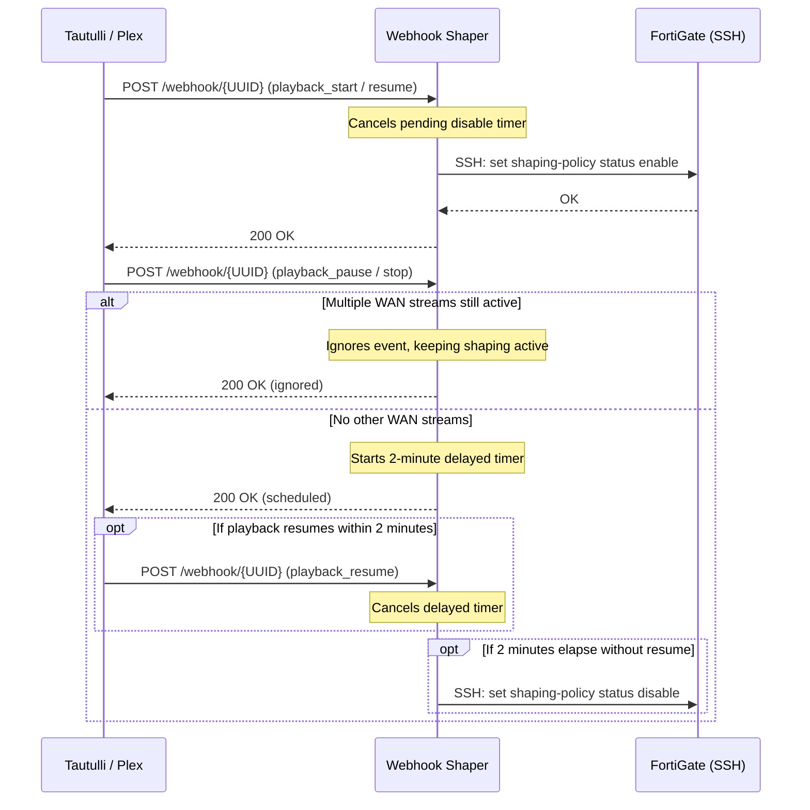

# FortiGate Webhook Shaper

A lightweight Flask/Gunicorn microservice that dynamically toggles FortiGate firewall traffic shaping policies over SSH in response to media streaming webhooks (e.g. from Tautulli or Plex).

When WAN media playback starts or resumes, the shaper enables prioritized traffic shaping policies on your FortiGate firewall. When playback pauses or stops, the service gracefully schedules a delayed disable (with automatic timer cancellation if playback resumes within 2 minutes).

## Architecture & Event Semantics



### Event Handling Logic

- **`playback_start` & `playback_resume`:**
  - Cancels any running delayed disable timer.
  - Connects to FortiGate over SSH and enables shaping policies (`status enable`).
- **`playback_pause`:**
  - If `wan_streams > 1`: Ignored (other remote streams are active).
  - If `wan_streams <= 1`: Schedules a 2-minute (120 s) delayed disable.
- **`playback_stop`:**
  - If `wan_streams >= 1`: Ignored (other remote streams are active).
  - If `wan_streams == 0`: Schedules a 2-minute (120 s) delayed disable.
- **Inactivity Watchdog:** A background thread checks every 5 minutes. If no recognised playback event (`playback_*`) has arrived for 2 hours (unknown events do not count as activity), it automatically sends a disable command to FortiGate as a safety measure.

## Configuration & Environment Variables

All settings support Docker secrets using the `_FILE` suffix (e.g. `FORTIGATE_PASS_FILE=/run/secrets/fgt_pass`):

| Variable | Required | Default | Description |
| --- | --- | --- | --- |
| `WEBHOOK_TOKEN` | **Yes** | — | Secret token used to authenticate webhook requests via the `X-Webhook-Token` header. Should be a random string >= 32 characters. Supports `WEBHOOK_TOKEN_FILE`. |
| `WEBHOOK_UUID` | No | *(empty)* | Optional UUID suffix for the endpoint (`/webhook/<UUID>`). If omitted, defaults to `/webhook/default`. |
| `FORTIGATE_HOST` | **Yes** | — | FortiGate hostname or IP address. Supports `FORTIGATE_HOST_FILE`. |
| `FORTIGATE_PORT` | No | `22` | FortiGate SSH port. |
| `FORTIGATE_USER` | **Yes** | — | SSH administrator username. Supports `FORTIGATE_USER_FILE`. |
| `FORTIGATE_PASS` | Conditional | — | SSH password. Required if `FORTIGATE_KEY_FILE` is not set. Supports `FORTIGATE_PASS_FILE`. |
| `FORTIGATE_KEY_FILE`| Conditional | — | Path to SSH private key file for key-based authentication. |
| `FORTIGATE_HOSTKEY` | Conditional | — | Pinned FortiGate public host key in format `<key-type> <base64-key>` (e.g. `ssh-ed25519 AAAAC3...`). Required unless `FORTIGATE_KNOWN_HOSTS` is specified. Supports `FORTIGATE_HOSTKEY_FILE`. |
| `FORTIGATE_KNOWN_HOSTS` | Conditional | — | Path to a `known_hosts` file for verifying FortiGate host keys. `FORTIGATE_KNOWN_HOSTS_FILE` is accepted as an alias and is also treated as the path of the `known_hosts` file (e.g. a Docker secret mounted at `/run/secrets/fgt_known_hosts`). |

### Host Key Pinning

The service enforces strict host key verification using Paramiko's `RejectPolicy` (rejecting unknown or changed keys):

1. **Direct host key string (`FORTIGATE_HOSTKEY`):** Obtain the key with `ssh-keyscan`:
   ```bash
   ssh-keyscan -t ed25519 -p 22 fortigate.example.com
   # Output: fortigate.example.com ssh-ed25519 AAAAC3NzaC1lZDI1NTE5...
   ```
   Set `FORTIGATE_HOSTKEY="ssh-ed25519 AAAAC3NzaC1lZDI1NTE5..."`.
2. **Known hosts file (`FORTIGATE_KNOWN_HOSTS`):** Mount a `known_hosts` file into the container and set the path.

## Webhook Payload & API

### Endpoint

- `POST /webhook/<WEBHOOK_UUID>` (or `/webhook/default` if `WEBHOOK_UUID` is unset)

### Headers

```http
Content-Type: application/json
X-Webhook-Token: <your-webhook-token>
```

### JSON Body

```json
{
  "event": "playback_start",
  "wan_streams": 1
}
```

- `event` (string, required): One of `playback_start`, `playback_resume`, `playback_pause`, `playback_stop`.
- `wan_streams` (integer, optional): Count of active WAN streams.

### Transport Security

The webhook is authenticated only by the static `X-Webhook-Token` header, and the container itself serves plain HTTP. Anyone who can observe a request can replay it, so:

- Do not expose port `25001` to untrusted networks. Keep the shaper on the same trusted host or network segment as Tautulli, or put it behind a TLS-terminating reverse proxy (Traefik, Caddy, nginx) and use an `https://` webhook URL.
- Use a long random `WEBHOOK_TOKEN` and a random `WEBHOOK_UUID`, and rotate the token if it may have been exposed.

## Tautulli Setup

1. In Tautulli, navigate to **Settings** > **Notification Agents** > **Add a new notification agent** > **Webhook**.
2. **Configuration:**
   - **Webhook URL:** `http://<shaper-host>:25001/webhook/<WEBHOOK_UUID>` (or `https://...` through your reverse proxy, see [Transport Security](#transport-security))
   - **Webhook Method:** `POST`
   - **Description:** `FortiGate Webhook Shaper`
3. **Headers:**
   ```json
   {
     "X-Webhook-Token": "<your-secret-token>"
   }
   ```
4. **Triggers:**
   - Check `Playback Start`
   - Check `Playback Stop`
   - Check `Playback Pause`
   - Check `Playback Resume`
5. **Data:**
   - Under **JSON Data**, set:
     ```json
     {
       "event": "{action}",
       "wan_streams": {wan_bandwidth}
     }
     ```
     *(Or pass `{stream_count}` or `{session_count}` depending on your stream tracking requirements).*

## Docker Deployment

Example `docker-compose.yml` using Docker secrets:

```yaml
services:
  shaper:
    image: ghcr.io/arumes31/fgt-webhook-shaper:latest
    container_name: fgt-webhook-shaper
    restart: unless-stopped
    ports:
      - "25001:25001"
    environment:
      - WEBHOOK_TOKEN_FILE=/run/secrets/webhook_token
      - WEBHOOK_UUID=my-custom-uuid-12345
      - FORTIGATE_HOST=192.168.1.1
      - FORTIGATE_USER_FILE=/run/secrets/fgt_user
      - FORTIGATE_PASS_FILE=/run/secrets/fgt_pass
      - FORTIGATE_HOSTKEY_FILE=/run/secrets/fgt_hostkey
    secrets:
      - webhook_token
      - fgt_user
      - fgt_pass
      - fgt_hostkey

secrets:
  webhook_token:
    file: ./secrets/webhook_token.txt
  fgt_user:
    file: ./secrets/fgt_user.txt
  fgt_pass:
    file: ./secrets/fgt_pass.txt
  fgt_hostkey:
    file: ./secrets/fgt_hostkey.txt
```
